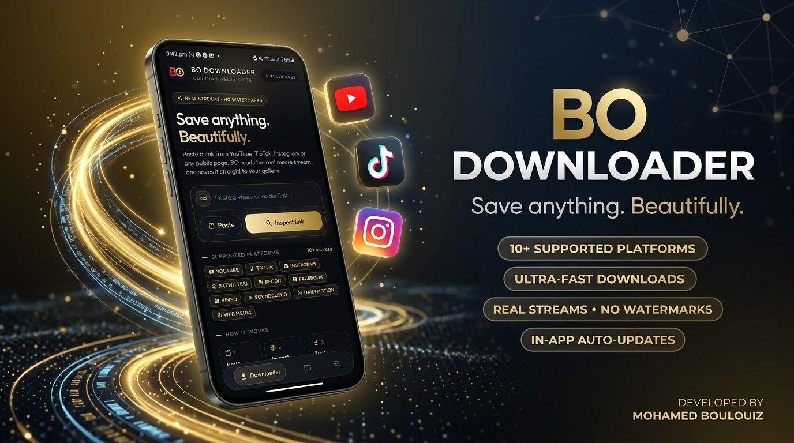

# 📥 BO Downloader

**BO Downloader** is a high-performance, sleek, and minimalist media downloader mobile application for Android, powered by Flutter and a robust FastAPI backend to save your favorite media beautifully and effortlessly.

---

## ✨ Key Features

- **Save Anything, Beautifully:** A sleek, minimalist dark & gold Obsidian-inspired user interface built for speed and clarity.
- **10+ Supported Platforms:** Direct, high-quality downloads from YouTube, TikTok, Instagram, X (Twitter), Facebook, Reddit, SoundCloud, Dailymotion, Vimeo, and more.
- **Ultra-Fast & Direct Streams:** Powered by a Python/FastAPI and `yt-dlp` engine to extract real media streams at maximum speed.
- **No Watermarks:** Save clean videos and high-bitrate audio directly to your device gallery.
- **Privacy First:** Zero tracking, zero intrusive ads — your links and downloads stay completely private on your device.
- **In-App Auto-Updates:** Automatically checks GitHub Releases for new versions and updates with a single tap.

---

## 📥 How to Download & Install (Android)

1. Go to the **[Latest Release](https://github.com/boulouizsimohamed-tech/BO-Downloader-Releases/releases/latest)** page (or click the **Download APK** badge above).
2. Under the **Assets** section, tap on **`BO-Downloader-v1.1.0.apk`** to download it to your Android device.
3. Open the downloaded `.apk` file from your notifications or File Manager.
4. If prompted by Android, enable **"Allow from this source"** (Install Unknown Apps) and tap **Install**.

---

## 🛠️ How It Works

1. **Paste:** Copy any public video or audio link and paste it into BO Downloader.
2. **Inspect:** Tap **Inspect link** to fetch available stream qualities and formats.
3. **Save:** Pick your preferred quality and save it straight to your gallery.

---

## 👨‍💻 Developer

Designed & Developed by **Mohamed Boulouiz**
- **GitHub:** [@boulouizsimohamed-tech](https://github.com/boulouizsimohamed-tech)
- **Portfolio:** [mohamed-boulouiz-portfolio.vercel.app](https://mohamed-boulouiz-portfolio.vercel.app)
